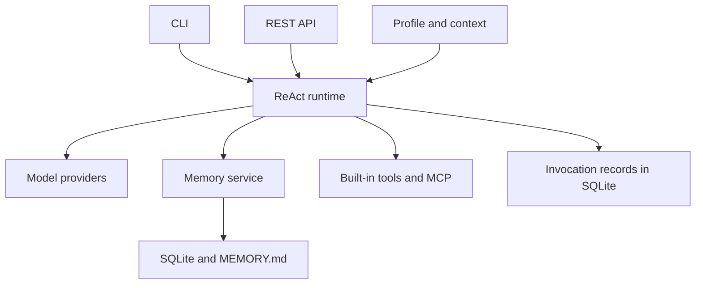

# OryxOS

[Project homepage (local)](website/index.html) · [Preview and maintenance](website/README.md)

**A Java-native runtime for configurable AI agents.**

English | [简体中文](README_CN.md)

[Documentation](docs/README.md) · [Roadmap](ROADMAP.md) · [Contributing](CONTRIBUTING.md) · [Changelog](CHANGELOG.md)

> **Status: build scaffold ready.** The nine-module Maven project compiles, tests, packages, and starts. Agent features remain unimplemented; there is no product release yet.

## Overview

OryxOS aims to provide a self-hosted foundation for business agents: configure an agent's identity, model, tools, and context through a Profile, then interact with it through a CLI or REST API. The runtime handles the model–tool loop, memory, and persistence.

The first release targets a single process and a trusted workspace. Enterprise governance is a later milestone. The local repository is named `my-agentos`; the product name is OryxOS.

## Planned capabilities

| Capability | First-release scope | Status |
| --- | --- | --- |
| Models | Explicit provider mapping; validate DeepSeek and Kimi | Planned |
| ReAct | Application-controlled model/tool loop with bounded iterations | Planned |
| Memory | Independent session histories; shared workspace long-term memory | Planned |
| Tools & Skills | File, shell, HTTP, memory, Java plugins, MCP tools, and basic Skill loading | Planned |
| Integration | 10 REST endpoints, 12 CLI commands, and multiple Profiles | Planned |
| Persistence | SQLite sessions and model/tool invocation records | Planned |

SSO, tenant isolation, full tool policies, container sandboxes, streaming, and distributed deployment are outside the first release. Requests to external models and tools can transmit data outside the deployment.

## Architecture



Build baseline: **JDK 21 · Spring Boot 3.5.16 · Maven 3.6.3+**. Spring AI / Spring AI Alibaba, SQLite, and Picocli are planned integrations; their versions remain to be validated.

OryxOS will control the ReAct loop and tool execution. Spring AI will provide protocol adaptation and tool schemas. See the [technical design](docs/技术方案文档.html) for the nine planned Maven modules and execution boundaries.

## Getting started

With JDK 21 and Maven 3.6.3+ available, run from the repository root:

```sh
mvn -B -ntp clean package
java -jar oryxos-boot/target/oryxos-boot-0.1.0-SNAPSHOT.jar
```

The current application starts a Spring Boot context and exits normally. It does not expose HTTP endpoints or interactive CLI commands yet, and requires no model credentials or database.

Run the standalone CLI version entry point with `java -jar oryxos-cli/target/oryxos-cli-0.1.0-SNAPSHOT.jar`. It prints `OryxOS 0.1.0-SNAPSHOT`.

See the [build guide](docs/BUILD.md) for module structure, tests, and artifact details. Design documents and their images remain readable offline under `docs/`. The complete product quickstart and five end-to-end demos are still pending.

## Documentation

The design documentation is currently in Chinese.

| Document | Purpose |
| --- | --- |
| [Research](docs/业界调研.html) | Motivation and longer-term direction; external claims require verification |
| [Requirements](docs/需求文档.html) | Functional scope and delivery requirements |
| [Technical design](docs/技术方案文档.html) | Architecture, modules, and storage |
| [AI development guide](docs/AI%20编程指南.html) | Planned specification-driven workflow |
| [Decisions](docs/DECISIONS.md) | Confirmed scope and behavior |
| [Tracking](docs/TRACKING.md) | Unresolved questions, work packages, and deferred items |
| [Acceptance](docs/ACCEPTANCE.md) | Release checks and evidence |

## Roadmap

The implementation sequence is **models → ReAct → memory and tools → REST API**, followed by full persistence, CLI, documentation, and release validation. See [ROADMAP.md](ROADMAP.md) for milestones. The original four-week estimate is not a release commitment.

## Contributing

Documentation corrections, reproducible problem reports, and scoped implementation proposals are welcome. Read [CONTRIBUTING.md](CONTRIBUTING.md) for the current workflow and validation expectations. The repository includes Issue and pull request templates for future GitHub hosting; no remote is configured yet.

AI coding tools should read [AGENTS.md](AGENTS.md). [CLAUDE.md](CLAUDE.md) is the Claude Code entry point.

## License

A project license has not been selected. License selection and review of third-party materials are tracked as Q-14 in [TRACKING.md](docs/TRACKING.md). No open-source license is claimed at this stage.
