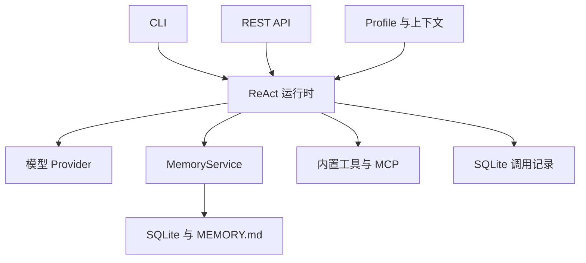

# OryxOS

**面向可配置 AI Agent 的 Java 原生运行时。**

[English](README.md) | 简体中文

[项目文档](docs/README.md) · [路线图](ROADMAP.md) · [参与贡献](CONTRIBUTING.md) · [变更记录](CHANGELOG.md)

[项目主页（本地）](website/index.html) · [主页预览与维护](website/README.md)

[GitHub 仓库](https://github.com/engineer-yang/my-agentos)（私有，需要访问权限）

> **项目状态：构建骨架已就绪。** 九模块 Maven 工程已通过编译、测试、打包及启动验证；Agent 业务能力仍待实现，尚无产品发布版本。

## 项目介绍

OryxOS 希望为业务 Agent 提供一套可私有部署的基础环境：通过 Profile 配置身份、模型、工具和上下文，通过 CLI 或 REST API 与 Agent 交互，由运行时负责模型与工具循环、记忆及持久化。

首版面向单进程、可信工作区，企业治理能力逐步演进。项目产品名为 OryxOS，本地仓库目录名为 `my-agentos`。

## 计划能力

| 能力 | 首版范围 | 状态 |
| --- | --- | --- |
| 模型接入 | 显式 Provider 映射，验证 DeepSeek 和 Kimi | 待实现 |
| ReAct | 自主控制模型与工具循环，限制迭代次数 | 待实现 |
| 记忆 | 独立会话历史、工作区共享长期记忆 | 待实现 |
| 工具与技能 | 文件、Shell、HTTP、记忆、Java 插件、MCP 工具和基础 Skill 加载 | 待实现 |
| 对外接入 | 10 个 REST 端点、12 个 CLI 命令、多个 Profile | 待实现 |
| 持久化 | SQLite 保存会话及模型/工具调用记录 | 待实现 |

SSO、多租户隔离、完整 Tool Policy、容器沙箱、流式响应和分布式部署留到后续。调用外部模型或工具时，相关请求数据可能离开私有部署环境。

## 整体架构



构建基线：**JDK 21 · Spring Boot 3.5.16 · Maven 3.6.3+**。Spring AI / Spring AI Alibaba、SQLite 和 Picocli 属于后续集成，具体版本仍待验证。

OryxOS 自己控制 ReAct 循环和工具执行，Spring AI 提供协议适配和工具 Schema。9 个 Maven 模块与执行边界见 [技术方案](docs/技术方案文档.html)。

## 快速开始

准备 JDK 21 和 Maven 3.6.3+，在项目根目录执行：

有仓库访问权限时，可先执行 `git clone https://github.com/engineer-yang/my-agentos.git`，然后进入 `my-agentos` 目录。

```sh
mvn -B -ntp clean package
java -jar oryxos-boot/target/oryxos-boot-0.1.0-SNAPSHOT.jar
```

当前程序启动 Spring Boot 上下文后正常退出，尚无 HTTP 接口和交互式 CLI，不需要模型密钥或数据库。

CLI 版本入口可独立运行：`java -jar oryxos-cli/target/oryxos-cli-0.1.0-SNAPSHOT.jar`，输出 `OryxOS 0.1.0-SNAPSHOT`。

模块结构、测试和产物说明见 [构建指南](docs/BUILD.md)。设计文档及配图仍可在 `docs/` 下离线阅读。完整产品快速开始和五个端到端 Demo 仍待实现。

## 项目文档

设计文档当前以中文维护。

| 文档 | 内容 |
| --- | --- |
| [业界调研](docs/业界调研.html) | 项目动机和长期方向；外部事实尚需核验 |
| [需求文档](docs/需求文档.html) | 功能范围与交付要求 |
| [技术方案](docs/技术方案文档.html) | 架构、模块和存储设计 |
| [AI 编程指南](docs/AI%20编程指南.html) | 计划采用的规格驱动开发流程 |
| [已确认决策](docs/DECISIONS.md) | 已确定的范围与行为 |
| [不一致与待办台账](docs/TRACKING.md) | 未决问题、工作包和延期事项 |
| [统一验收清单](docs/ACCEPTANCE.md) | 发布检查及证据要求 |

## 路线图

按 **模型接入 → ReAct → 记忆与工具 → REST API** 推进，再补齐持久化、CLI、文档和发布验证。完整里程碑见 [ROADMAP.md](ROADMAP.md)。原四周估算不作为发布时间承诺。

## 参与贡献

欢迎文档修正、可复现的问题报告和范围明确的实现建议。协作流程与验证要求见 [CONTRIBUTING.md](CONTRIBUTING.md)。仓库已托管到 GitHub，并准备 Issue 和 PR 模板；当前为私有仓库，参与者需要访问权限。

AI 编程工具请先阅读 [AGENTS.md](AGENTS.md)；Claude Code 使用 [CLAUDE.md](CLAUDE.md) 作为入口。

## 许可证

项目尚未选择许可证。许可证选定及第三方资料分发条件记录在 [台账 Q-14](docs/TRACKING.md)，当前不宣称已采用任何开源许可证。
